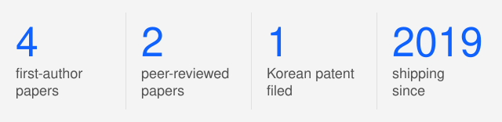
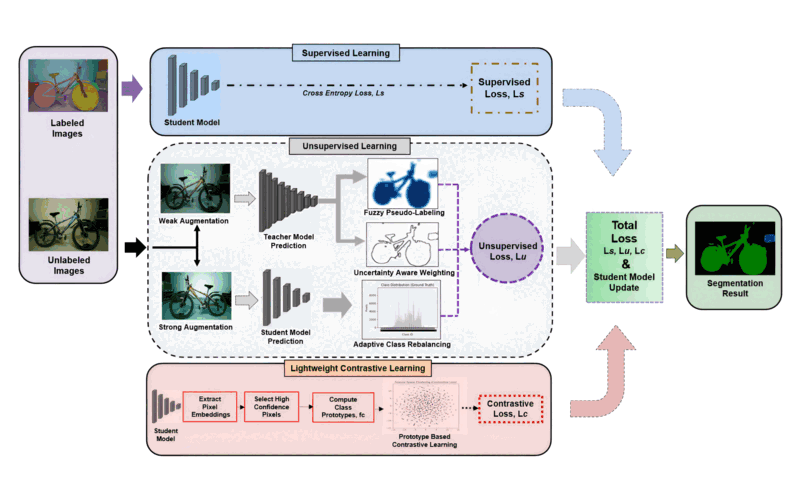
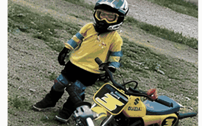
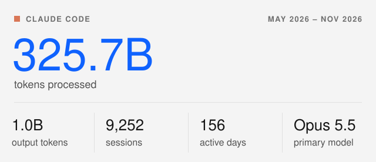

<!--
  Profile README — © 2026 Ebenezer "Ebstar" Tarubinga · github.com/psychofict
  Design & layout licensed under CC BY 4.0 (see LICENSE).
  Reuse is welcome — please keep visible attribution to Ebenezer Tarubinga.

  FACTS THAT AGE — verify before editing (last swept 2026-11-06):
  · Paper statuses match ebstar.co/ai, psychofict.github.io and the CV. CW-BASS v2 is a
    preprint (arXiv 2608.12773); PixCon reads "Under review". By the author's decision of
    2026-11-04, neither paper names a target venue in this file (comments included) or in
    a new commit message until he says so. FARCLUSS is the version of record:
    Neural Networks vol. 205 (January 2027 issue), article 109494,
    doi:10.1016/j.neunet.2026.109494, online 13 Aug 2026.
  · Leaderboard ranks: Papers with Code SHUT DOWN 24 Jul 2025 and now redirects to
    Hugging Face, so the CW-BASS #3 and FARCLUSS #2 ranks cannot be re-verified and are
    written as "at release". Do not restate them as current. PixCon's #2 follows
    ebstar.co/ai and the CV. CW-BASS v2's "2nd among DINOv2 methods" is checkable
    against tab:landscape / tab:sota_cs in its own paper (behind UniMatch V2-B); the
    paper deliberately claims no peak accuracy, so do not upgrade this to a SOTA claim.
  · The result line under each paper card repeats the portfolio's; change both together.
  · Claude Code usage card — NEVER edit the numbers by hand; regenerate with
    scripts/refresh-stats.py (reads ~/.config/claude-token-tracker/history.db).
    The "at a glance" card is drawn by scripts/cards.py; edit GLANCE there.
  · Stats/streak cards are self-hosted (grs-iota.vercel.app / streak-kappa.vercel.app);
    their GitHub tokens died once already (2026-08). If a card shows "Something went
    wrong", check those Vercel projects' env tokens first.
-->

<!-- ====================== HEADER BANNER ====================== -->

<!-- ====================== TYPING SUBTITLE ====================== -->

  

<!-- ====================== SOCIAL BADGES ====================== -->

  
  
  
  
  
  
  
  
  

  
  

<!-- ====================== INTRO ====================== -->

**I build AI systems that hold up in production** — the unglamorous part where a demo becomes something a city runs on. I'm an AI/ML engineer at [Gractor](https://www.gractor.com/), a smart-city AI company, working on retrieval, tool-calling agents, on-device vision and the evaluation harnesses that keep them honest. I also founded [Ebenworks](https://ebenworks.co), an AI product company, and designed, engineered and built every one of its products end to end.

During my **MSc in AI at Korea University's [Pattern Recognition & Machine Learning Lab](http://xai.korea.ac.kr/)** (advised by [Prof. Seong-Whan Lee](https://pure.korea.ac.kr/en/persons/seong-whan-lee), IEEE Fellow) I published two first-author papers on **semi-supervised semantic segmentation**. I have continued that line independently since then: **four papers** in all, the two newest on foundation-model backbones.

<!-- ====================== AT A GLANCE (scripts/cards.py) ====================== -->

  <picture>
    <source media="(prefers-color-scheme: dark)" srcset="https://raw.githubusercontent.com/psychofict/psychofict/main/assets/glance-dark.svg?v=20261106" />
    
  </picture>

<!-- ====================== PUBLICATIONS ====================== -->
## &#128300; Research

Four mechanisms for one problem: learning to label every pixel from a handful of examples, without letting the model's own mistakes compound.

<table>
<tr>
<td width="50%" valign="top">

 <b>PREPRINT</b> · 2026 · 2nd among DINOv2 methods&nbsp;‡
 <b>CW-BASS&nbsp;v2</b>: Saturation-Aware Pseudo-Label Selection for Semi-Supervised Segmentation under Foundation-Model Teachers
 Held-out calibration and a reliability-gated selection rule. Picks correctly on all six DINOv2 teachers, blind · +1.5 mIoU on ADE20K
 <a href="https://arxiv.org/abs/2608.12773">arXiv</a> · <a href="https://github.com/psychofict/CW-BASS-v2">Code</a> · <a href="https://psychofict.github.io/CW-BASS-v2/">Project</a> · <a href="https://huggingface.co/psychofict">Models</a>
</td>
<td width="50%" valign="top">

 <b>UNDER REVIEW</b> · 2026 · #2&nbsp;‡
 <b>PixCon</b>: Clean-Positive Contrastive Learning for Foundation-Model Semi-Supervised Segmentation
 A contamination-free pixel memory bank, backed by a supervised-InfoNCE gradient analysis. Beats a compute-matched UniMatch V2 on every Pascal-1/8 seed · 87.90 mIoU, three-seed mean
 <a href="https://arxiv.org/abs/2607.03068">arXiv</a> · <a href="https://github.com/psychofict/PixCon">Code</a> · <a href="https://psychofict.github.io/PixCon/">Project</a>
</td>
</tr>
<tr>
<td width="50%" valign="top">

 <b>NEURAL NETWORKS 205</b>&nbsp;* · Q1 · Top 10% IF · #2 at release&nbsp;‡
 <b>FARCLUSS</b>: Fuzzy Adaptive Rebalancing and Contrastive Uncertainty Learning for Semi-Supervised Semantic Segmentation
 Fuzzy top-K pseudo-labels, entropy-based uncertainty weighting and adaptive class rebalancing. 78.8 / 78.2 mIoU on Cityscapes and Pascal VOC, ResNet-101
 <a href="https://doi.org/10.1016/j.neunet.2026.109494">Elsevier</a> · <a href="https://arxiv.org/abs/2506.11142">arXiv</a> · <a href="https://github.com/psychofict/FARCLUSS">Code</a> · <a href="https://psychofict.github.io/FARCLUSS/">Project</a>
</td>
<td width="50%" valign="top">

 <b>IEEE IJCNN 2025</b>&nbsp;† · CORE A · #3 at release&nbsp;‡
 <b>CW-BASS</b>: Confidence-Weighted Boundary-Aware Learning for Semi-Supervised Semantic Segmentation
 Confidence-weighted pseudo-labels with boundary-aware regularization and dynamic thresholds. 77.15 mIoU on Pascal VOC 2012, ResNet-50 · 65.9 on Cityscapes from 100 labeled images
 <a href="https://ieeexplore.ieee.org/document/11227871/">IEEE</a> · <a href="https://arxiv.org/abs/2502.15152">arXiv</a> · <a href="https://github.com/psychofict/CW-BASS">Code</a> · <a href="https://psychofict.github.io/CW-BASS/">Project</a>
</td>
</tr>
</table>

**Research areas:** `Semi-supervised learning` · `Semantic segmentation` · `Pseudo-labeling & consistency` · `Calibration & uncertainty` · `Contrastive representation learning` · `Long-tailed / class imbalance` · `Boundary-aware learning` · `Foundation models (DINOv2, ViT)` · `Selective prediction` · `Evaluation methodology`

‡ Ranks are as at each paper's release, not live standings; Papers with Code closed in July 2025. CW-BASS v2's 2nd is among DINOv2-backbone methods, behind UniMatch V2-B. The first two papers ran on ResNet backbones; the newest two move the line onto DINOv2.
 \* Neural Networks (Elsevier): Q1 and top 10% by impact factor (JCR), and the archival journal of the International, European and Japanese Neural Network Societies (INNS, ENNS, JNNS).
 † IEEE IJCNN is run by INNS with the IEEE Computational Intelligence Society; CORE A (2020).
  The authoritative, always-current list is my ORCID record: [orcid.org/0009-0004-7340-1873](https://orcid.org/0009-0004-7340-1873)

<!-- ====================== OPEN SOURCE ====================== -->
## &#128736;&#65039; Open Source

**[hwpkit](https://github.com/psychofict/hwpkit)** · PYTHON · OLE/CFB · [ON PYPI](https://pypi.org/project/hwpkit/)
 Read, fill and edit Korean HWP (Hancom Office) documents in Python: text extraction for LLM/RAG pipelines, programmatic form-filling, and a binary rewrite that doesn't corrupt the file.

**[tzohar-engine](https://github.com/psychofict/tzohar-engine)** · TYPESCRIPT · NEXT.JS · APACHE-2.0
 A framework for personal and academic websites: typed section blocks, ORCID and BibTeX ingestion, and a licence that leaves the owner holding their own copy.

**[claudehop](https://github.com/psychofict/claudehop)** · PYTHON · ONE FILE · NO DEPENDENCIES
 Use several Claude Code accounts on one machine: move every terminal to another login in one keystroke, or run a different account in each terminal.

**[Claude Usage Widget & Token Tracker](https://github.com/StaticB1/claude_ai_usage_widget)** · PYTHON · GTK · CLI
 A live system-tray widget for Claude Code plan limits (5h/7d), plus local token and cost analytics per project, model and tool.

The training code, configs and released checkpoints for all four papers are open too: [CW-BASS&nbsp;v2](https://github.com/psychofict/CW-BASS-v2) · [PixCon](https://github.com/psychofict/PixCon) · [FARCLUSS](https://github.com/psychofict/FARCLUSS) · [CW-BASS](https://github.com/psychofict/CW-BASS) · [Models on Hugging Face](https://huggingface.co/psychofict)

<!-- ====================== CLAUDE CODE USAGE (scripts/refresh-stats.py) ====================== -->
## &#9889; Building with Claude Code

I build with agentic coding daily. The figures come from my local Claude Code telemetry; background sessions of a memory plugin are left out.

<!-- CLAUDE-STATS:START -->

  <picture>
    <source media="(prefers-color-scheme: dark)" srcset="https://raw.githubusercontent.com/psychofict/psychofict/main/assets/claude-usage-dark.svg?v=20261106" />
    
  </picture>

<!-- CLAUDE-STATS:END -->

<!-- ====================== TECH STACK ====================== -->
## &#129504; Tech Stack

  <picture>
    <source media="(prefers-color-scheme: dark)" srcset="https://skillicons.dev/icons?i=py%2Cts%2Cjs%2Ccpp%2Ccs%2Cjava%2Cbash%2Cpytorch%2Ctensorflow%2Copencv%2Csklearn%2Cfastapi%2Cflask%2Cnodejs%2Cexpress%2Cprisma%2Cpostgres%2Cmongodb%2Credis%2Csqlite%2Creact%2Cnextjs%2Cthreejs%2Ctailwind%2Cvite%2Cdocker%2Ckubernetes%2Caws%2Cnginx%2Cgrafana%2Cprometheus%2Ccloudflare%2Cvercel%2Cgithubactions%2Clinux%2Cgit&perline=12&theme=dark" />
    
  </picture>

<b>The full stack, by area</b>

 

**AI / LLM Systems**

  
  
  
  
  
  
  
  
  
  

**ML / Computer Vision**

  
  
  
  
  
  
  
  
  
  
  
  

**Backend & Data**

  
  
  
  
  
  
  
  
  
  
  
  
  

**Frontend**

  
  
  
  
  
  
  
  
  
  
  

**Infra / DevOps / IoT**

  
  
  
  
  
  
  
  
  
  
  
  

**Languages**

  
  
  
  
  
  
  
  

<!-- ====================== GITHUB STATS ====================== -->
## &#128202; GitHub Stats

  <picture>
    <source media="(prefers-color-scheme: dark)" srcset="https://grs-iota.vercel.app/api?username=psychofict&show_icons=true&count_private=true&include_all_commits=true&hide=contribs&hide_border=true&theme=tokyonight&title_color=6AA6FF&icon_color=6AA6FF&text_color=c9d1d9&bg_color=0d1117&cb=2" />
    
  </picture>
  <picture>
    <source media="(prefers-color-scheme: dark)" srcset="https://grs-iota.vercel.app/api/top-langs/?username=psychofict&layout=compact&langs_count=8&hide_border=true&theme=tokyonight&title_color=6AA6FF&text_color=c9d1d9&bg_color=0d1117&cb=2" />
    
  </picture>

  <picture>
    <source media="(prefers-color-scheme: dark)" srcset="https://streak-kappa.vercel.app?user=psychofict&theme=tokyonight&hide_border=true&background=0D1117&ring=6AA6FF&fire=6AA6FF&currStreakLabel=6AA6FF&sideNums=c9d1d9&sideLabels=8b949e&dates=8b949e&stroke=0D1117&cb=3" />
    
  </picture>

<!-- ====================== CONTRIBUTION SNAKE ====================== -->

  <picture>
    <source media="(prefers-color-scheme: dark)" srcset="https://raw.githubusercontent.com/psychofict/psychofict/output/github-contribution-grid-snake-dark.svg" />
    <source media="(prefers-color-scheme: light)" srcset="https://raw.githubusercontent.com/psychofict/psychofict/output/github-contribution-grid-snake.svg" />
    
  </picture>

<!-- ====================== EXPERIENCE ====================== -->
## &#128188; Experience

**AI/ML Engineer** · Gractor Co., Ltd. · SEPT 2025 – PRESENT · SEOUL
 Production retrieval (RAG) and tool-calling agent systems for smart-city platforms, with guardrails at the tool boundary and evaluation harnesses that cover adversarial inputs. Computer-vision models for urban sensing, with on-device inference on municipal edge hardware.

**Founder** · [Ebenworks](https://ebenworks.co) · 2026 – PRESENT · SEOUL
 An AI product company. I designed, engineered and built every Ebenworks product end to end, turning applied AI research into shipped software.

**Research Engineer (MSc)** · [Korea University](http://xai.korea.ac.kr/), PRML Lab · AUG 2023 – FEB 2026 · SEOUL
 Advised by Prof. Seong-Whan Lee (IEEE Fellow). Two first-author segmentation papers there (#3 and #2 on the Papers with Code leaderboards at release, 2025); about 10K lines of multi-GPU PyTorch training infrastructure; a Korean patent application filed (autonomous-driving perception).

**AI Software Engineer** · GliT, EdTech · JAN 2019 – JAN 2021 · HYBRID
 Delivered 10+ full-cycle product builds end to end, led the startup's technical direction, and ran STEM programmes with 10+ partner schools.

## &#127891; Education &amp; Recognition

**MSc in Artificial Intelligence** · Korea University · 2023 – 2026 · GPA 3.78/4.0
 Global Korea Scholarship (sole awardee from Zimbabwe, 2022) · BK21 Research Fellowship · Advisor: [Prof. Seong-Whan Lee](https://pure.korea.ac.kr/en/persons/seong-whan-lee)

**GINCON Global Committee member** · APPOINTED 2025 · NATIONAL ASSEMBLY OF KOREA

<!-- ====================== FOOTER ====================== -->
 

  <a href="mailto:ebstarmusic@gmail.com"><b>Let's build something that ships.</b></a>

  

Like this profile? Reuse the design with attribution to <a href="https://github.com/psychofict">Ebenezer Tarubinga</a>. See <a href="./LICENSE">LICENSE</a>.

